# Afyaware Clinic, Pharmacy & Diagnostic Center OS — Phased Development Roadmap

> **Goal:** Build **Afyaware** from scratch into a complete, production-ready, Vercel-deployed Outpatient Clinic, Pharmacy & Diagnostic Center OS (SHA/SHIF, M-Pesa Daraja & KRA eTIMS ready) covering all 27 modules outlined in [`afyaware-project-overview.md`](./afyaware-project-overview.md).

---

## Architecture & Tech Stack (Vercel-Optimized)

- **Framework:** Next.js 15 (App Router, TypeScript, React 19)
- **Styling & UI:** Tailwind CSS + Lucide Icons + Custom Healthcare High-Density Clinical UI Components (Dark/Light mode, keyboard-friendly workflows, print/PDF-ready templates)
- **State & Data Layer:**
  - Dual-mode data engine: Prisma ORM + PostgreSQL (Neon / Supabase for live Vercel production) **plus** a rich, pre-seeded Interactive Persistence Layer (IndexedDB/LocalStorage + Server API routes) so the app works immediately on Vercel zero-config and with a live cloud database.
- **Authentication & RBAC:** Role-Based Access Control with instant role-switcher for demo/testing & strict **Clinical Privacy Lock** (Doctor, Nurse/Triage, Lab Tech, Radiographer, Pharmacist, Cashier, Receptionist, Claims Officer, Storekeeper, Clinic Director).
- **Document & Receipt Generation:** Built-in print/PDF views for KRA eTIMS Thermal Receipts, Dosage Stickers (English/Swahili), Lab Reports with QR Verification, Clinical Referral Letters, Sick-Off Sheets, and MOH 705A/705B/706/710 Statutory Reports.

---

## Phased Development Roadmap

```mermaid
flowchart LR
    P1["Phase 1: Foundation, RBAC & Live Ops Shell"] --> P2["Phase 2: EMPI, Multi-Resource Scheduling & Triage"]
    P2 --> P3["Phase 3: Doctor EMR, ICD-10/11, Worklists & Consents"]
    P3 --> P4["Phase 4: LIS (Lab), Radiology & Minor Theatre / Day-Ward"]
    P4 --> P5["Phase 5: Pharmacy POS, E-Prescriptions & FEFO Inventory"]
    P5 --> P6["Phase 6: Cashier, Split Billing, M-Pesa, eTIMS & SHA/Insurance"]
    P6 --> P7["Phase 7: Specialist Clinics, Referrals, Commissions & CRM"]
    P7 --> P8["Phase 8: MOH KHIS Reports, Multi-Branch, Portal & Vercel Deploy"]
```

---

### Phase 1: Project Foundation, RBAC Security & Clinic Live Operations Shell
**Modules Covered:** `#23 Clinic Live Operations Workspace`, `#25 Notifications & Clinical Alerts`, `#27 System Administration, Security & Integrations`
1. **Scaffold Next.js TypeScript App** in the workspace with Tailwind CSS, healthcare color tokens, and responsive clinical layout.
2. **Core Data Schema & Kenyan Healthcare Seed Data:**
   - Pre-loaded realistic Kenyan patients, SHA/SHIF & private insurers (Jubilee, AAR, Britam, CIC, Minet), ICD-10 codes, Kenya Essential Medicines List (KEML) batches, lab test catalogues, rooms, and diagnostic machines.
3. **Role-Based Access Control (RBAC) & Clinical Privacy Lock:**
   - 10 granular clinical/operational roles + immutable Audit Trail logger.
   - Enforced **Clinical Privacy Lock** hiding confidential consultation notes and diagnoses from Cashier/Reception views.
4. **Executive Dashboard & Live Operations Command Center (`#23`):**
   - Real-time KPI cards (Visits Today, Waiting Queue, Critical Lab Alerts, M-Pesa vs. SHA/Insurance Revenue, Expiry Radar `<60d`, Unsubmitted Claims).
   - Live Patient Flow tracker across stations, Resource/Room occupancy grid, Long Wait-Time alerts (`>30 mins`), and Global Clinical Alert Notification Center (`#25`).

---

### Phase 2: Patient Master Index (EMPI), Multi-Resource Scheduling & Triage Station
**Modules Covered:** `#1 Patient Registration & EMPI`, `#2 Appointments, Resource Scheduling & Smart Queue`, `#3 Triage & Nursing Station`
1. **Patient Master Index (`#1`):**
   - Fast `<15s` patient registration & lookup (Phone, Name, National ID, UPN/OP Number, SHA Member No).
   - Principal & Family/Dependant linking, Payment Scheme tagging at check-in, and persistent clinical banner (**Allergies, Chronic Conditions, Blood Group/Rhesus**).
2. **Multi-Resource Appointment & Smart Queue System (`#2`):**
   - 4D Booking Engine: `Doctor + Consultation/Procedure Room + Diagnostic Equipment + Time Slot` with real-time **Conflict Detection**.
   - Live Department Queue board (`Reception → Triage → Consultation → Lab → Imaging → Pharmacy → Cashier → Discharged`) with wait-time stopwatch, Emergency/Stat priority jump, and **Waiting Room TV Display Mode** (with audio chime trigger).
3. **Triage & Nursing Station (`#3`):**
   - Vital signs capture (BP, Pulse, Temp, RR, SpO2, Weight, Height, auto-BMI, pediatric MUAC, RBS/FBS).
   - Automatic color-coded abnormality flags (e.g., Hypertensive Crisis, Pyrexia), 5-visit historical vitals trend chart, and station routing.

---

### Phase 3: Single-Screen Doctor EMR, Clinical Worklists, Document Vault & Consents
**Modules Covered:** `#4 EMR & Consultation`, `#5 Clinical Document Vault`, `#6 Patient Consent & Clinical Forms`, `#7 Clinical Task & Worklist Management`
1. **Single-Screen Doctor Consultation Workspace (`#4`):**
   - Unified view of Triage Vitals, Past Visits, Active Meds, Lab/Imaging Results, and Uploaded Documents.
   - Structured SOAP/Clinical Notes with 1-click quick-text clinical macros (URTI, Malaria, UTI, Gastritis, Hypertension).
   - Searchable **ICD-10 / ICD-11 Diagnosis Coding** (Provisional vs. Confirmed).
   - Unified Clinical Order composer (Lab Tests, Imaging, Nursing Procedures, E-Prescriptions) + 1-click **Sick-Off Sheet & Medical Fitness Certificate** generator.
2. **Clinical Task & "Requires Action" Worklists (`#7`):**
   - Role-based queues for Doctors (Lab/Imaging ready for review, Critical values to acknowledge), Nurses (Pending injections/dressings, Observation vitals), and Reception/Claims, plus Shift Handover tracking.
3. **Clinical Document Vault (`#5`) & Digital Consents (`#6`):**
   - Upload/preview attachments linked at Patient, Visit, or Order level.
   - Digital Consent Templates (Minor Surgery, Dental, Maternity, HIV Testing, Kenya DPA Privacy) with interactive signature pad, witness sign-off, versioning, and **Mandatory Procedure Gate**.

---

### Phase 4: Laboratory (LIS), Radiology/Imaging & Minor Theatre / Observation Ward
**Modules Covered:** `#9 Laboratory Information System (LIS)`, `#10 Radiology & Imaging`, `#11 Minor Theatre, Nursing Procedures & Observation Day-Ward`
1. **Laboratory Information System (`#9`):**
   - End-to-end workflow: Order → **Billing Gate check** → Sample Collection & Barcode Label → Result Entry with Age/Gender reference ranges → Auto Abnormal/Critical Panic Value flags → Technologist Verification.
   - **Automatic Reagent & Consumables Deduction** per test performed (preventing off-book cash tests), External Reference Lab tracking (Lancet/PathCare), and Branded QR Lab Report PDF.
2. **Radiology, Imaging & Diagnostic Procedures (`#10`):**
   - Modality templates (Pelvic/Obstetric Ultrasound, Chest X-Ray, 12-Lead ECG), Billing & Consent clearance gate, image attachment viewer, and Radiologist sign-off.
3. **Minor Theatre, Nursing Procedures & Observation Day-Ward (`#11`):**
   - Procedure execution with automatic billing of both **Procedure Fee + Consumables Used**.
   - **Observation Day-Bed Visual Board (Beds 1–10)** with hourly vitals, IV fluid Input/Output balance chart, and automated day-bed timer billing.

---

### Phase 5: Pharmacy E-Prescription Queue, Retail OTC POS & FEFO Drug Inventory
**Modules Covered:** `#13 Pharmacy Management & POS`, `#14 Drug Inventory, Batch, FEFO & Expiry Control`, `#19 Procurement & Replenishment (Vensure Ready)`
1. **Clinical E-Prescription & Walk-In Retail POS (`#13`):**
   - Real-time Doctor E-Prescription queue + standalone fast OTC Barcode POS.
   - Pharmacist safety checks: Drug–Allergy modal warnings, Drug–Drug interaction alerts, Generic substitution, and Partial Dispensing tracker.
   - One-click **Thermal Dosage Sticker Printer** (with English & Swahili instructions: e.g., *Meza tembe moja mara tatu kwa siku*).
2. **Batch, FEFO & Expiry Control (`#14`):**
   - Strict **FEFO (First-Expiry, First-Out)** batch deduction & hard block on expired batches.
   - Expiry Radar (`<30d`, `<60d`, `<90d`, `<180d`), Controlled/Narcotic Drugs Register (PPB compliant), Multi-Store transfers (Main Store → Pharmacy → Triage → Lab), and Blind Stock-Take variance auditing.
3. **Procurement & Supplier Replenishment (`#19`):**
   - Reorder alerts, distributor price comparison (Surgipharm, Phillips, Medisel, etc.), Purchase Orders (PO), Goods Received Notes (GRN) with bonus packs, and **Vensure** ecosystem handoff hook.

---

### Phase 6: Cashier, Split Billing, M-Pesa Daraja, KRA eTIMS, Account Ledgers & SHA/Insurance
**Modules Covered:** `#15 Cashier, M-Pesa & KRA eTIMS`, `#16 Patient Billing Statements & Account Ledger`, `#17 SHA/SHIF & Private Insurance Claims`
1. **Cashier, Split Billing, M-Pesa & KRA eTIMS (`#15`):**
   - Configurable **Pay-Before-Service Billing Gates** for Cash patients vs. auto-clearance for covered Insurance items.
   - **Multi-Tender Split Billing** on a single invoice (e.g., SHA/Insurance + M-Pesa Co-pay + Cash).
   - Interactive **M-Pesa Daraja STK Push & C2B Till/Paybill Auto-Matcher** + **KRA eTIMS Validated Receipt** generator with QR code.
   - Blind Cashier Shift Handover & Cash-Up reconciliation + Manager PIN approval for refunds/waivers.
2. **Patient, Family & Corporate Account Ledgers (`#16`):**
   - Running ledger across visits (Invoices, Deposits, Installment packages for ANC/Dental/Optical, Credit Notes, Net Balance) and Corporate debtor statements.
3. **SHA/SHIF & Private Insurance Claims Engine (`#17`):**
   - Payer Rule Engine (Co-pays, Visit Caps, Pre-Auth codes, Exclusions routing to cash bill).
   - Claims Scrubbing & Vetting pipeline (`Visit Completed → Vetted → Batched → Submitted → Remittance Reconciled`) + 30/60/90/120+ day Aging Tracker.

---

### Phase 7: Specialist Clinic Templates, Clinical Referrals, Doctor Commissions & Chronic CRM
**Modules Covered:** `#8 Specialist Clinic Templates`, `#12 Clinical Referral Management`, `#18 Doctor Commissions & Locum Payouts`, `#20 Patient Engagement & Chronic Care CRM`
1. **Specialist Clinic Templates (`#8`):**
   - **Interactive Dental Odontogram** (32-tooth visual chart for caries, fillings, extractions, crowns).
   - **MCH / ANC & KEPI Immunization Tracker** (Gestation/EDD calculator, vaccine schedule, pediatric growth metrics).
   - **Optical / Eye Refraction Workspace** (VA, Sphere, Cylinder, Axis, PD, Add & spectacle prescription print).
   - **Chronic Disease Flowsheets** (Hypertension & Diabetes HbA1c/glucose longitudinal tracker).
2. **Incoming & Outgoing Clinical Referrals (`#12`):**
   - Incoming referral logging & feedback loop; Outgoing hospital referral composer with standardized **MOH / Clinical Referral Letter PDF**.
3. **Doctor Commissions & Locum Payouts (`#18`):**
   - Automated consultant revenue splits (e.g., 70/30), procedure commissions, locum shift logs, and monthly Payout Statements with **5% KRA Withholding Tax** calculation.
4. **Patient Engagement & Chronic Care CRM (`#20`):**
   - Automated Day-27 Medication Refill SMS/WhatsApp queue, 24h Appointment review reminders, Lab Result Ready alerts, and Post-Visit CSAT ratings.

---

### Phase 8: Statutory MOH (KHIS) Reporting, Multi-Branch Network, Patient Portal & Live Vercel Deployment
**Modules Covered:** `#21 Patient Portal & Wallet`, `#22 Telemedicine & Home Phlebotomy`, `#24 Clinical, Financial & MOH (KHIS) Reporting`, `#26 Multi-Branch Network`, **Production Vercel Deployment**
1. **Financial, Operational & Kenyan MOH (KHIS) Statutory Reports (`#24`):**
   - Automated **MOH 705A** (Under 5 Morbidity), **MOH 705B** (Over 5 Morbidity), **MOH 706** (Lab Summary), **MOH 710** (Immunization), plus Lab Reagent vs. Billed Tests Variance Report (theft detection) and Department Revenue reports.
2. **Multi-Branch Clinic & Pharmacy Network (`#26`):**
   - Branch switcher (e.g., *Westlands Main*, *Thika Road*, *Mombasa Road*) with shared cross-branch EMPI/Ledger, inter-branch drug stock transfers in transit, and Head Office consolidated view.
3. **Patient Digital Health Wallet (`#21`) & Telemedicine / Home Phlebotomy (`#22`):**
   - Patient-facing portal view (prescriptions, lab results, statement wallet, refill requests) + Tele-consultation screen & Home Sample Collection dispatch (**Fleesio** ready).
4. **Production Verification & Live Vercel Deployment:**
   - Full production build verification (`next build`), TypeScript/lint validation, and live deployment to **Vercel** with public URL verification.
